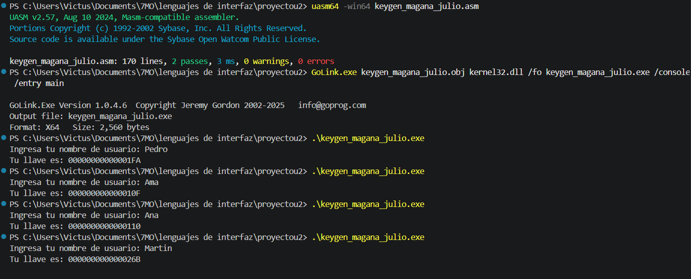

# Proyecto Módulo 2 - Keygen Básico

**Alumno:** Julio Alejandro Magaña Nuñez  
**Materia:** Lenguajes de Interfaz (SCC-1014)  
**Archivo:** `keygen_magana_julio.asm`

## Descripción del proyecto

Este programa hecho en ensamblador (x86-64) funciona como un generador de llaves básico en la consola de Windows usando `kernel32.dll`.

Lo que hace el programa es:
1. Pedir al usuario que escriba su nombre en la consola.
2. Revisar que el nombre no esté vacío (si solo presionas `Enter`, muestra un mensaje de error y termina).
3. Sumar el valor ASCII de cada letra del nombre ingresado.
4. Convertir esa suma a un número hexadecimal de 16 dígitos y mostrarlo en pantalla como la llave generada.

## Instrucciones de compilación

Para compilar y crear el ejecutable con **UASM64** y **GoLink**, abre la terminal en la carpeta del proyecto y corre estos comandos:

```powershell
uasm64 -win64 keygen_magana_julio.asm
GoLink.exe keygen_magana_julio.obj kernel32.dll /fo keygen_magana_julio.exe /console /entry main
```

Para ejecutarlo en PowerShell:

```powershell
.\keygen_magana_julio.exe
```

## Captura de pantalla


